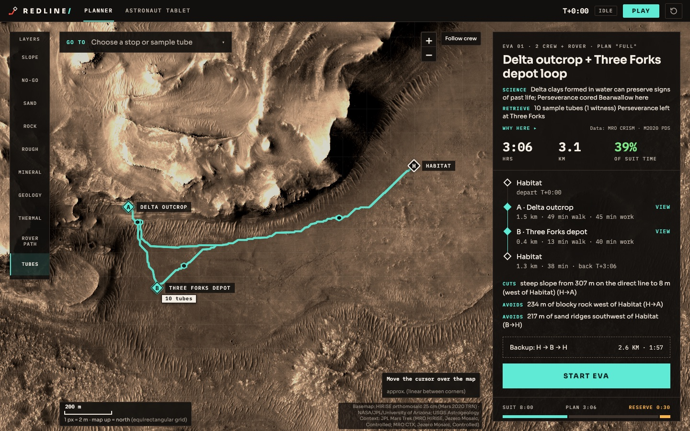
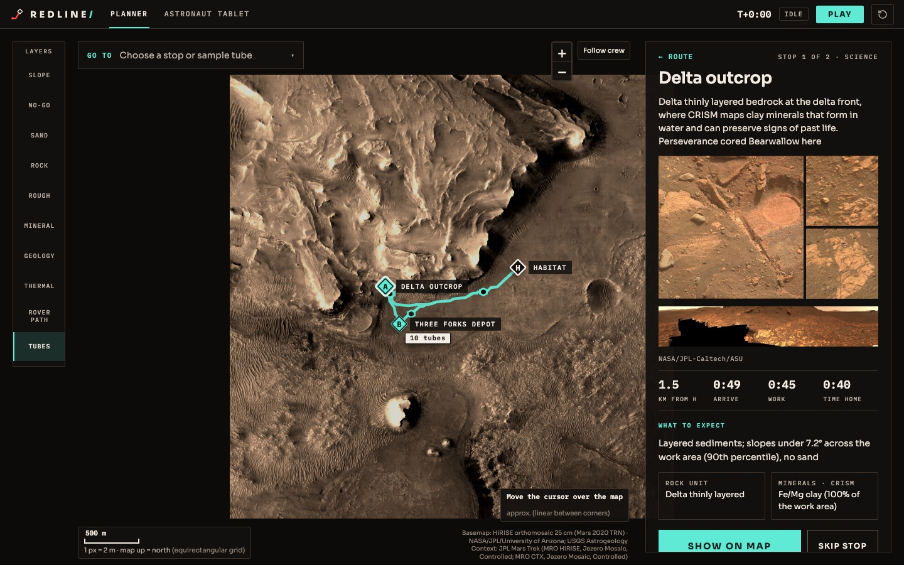
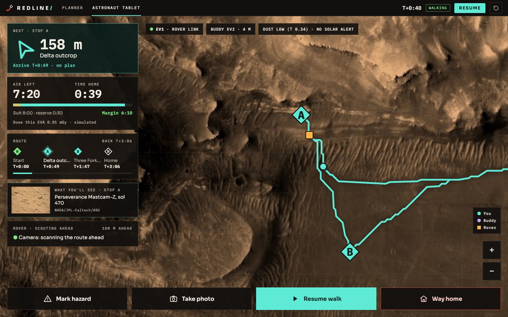
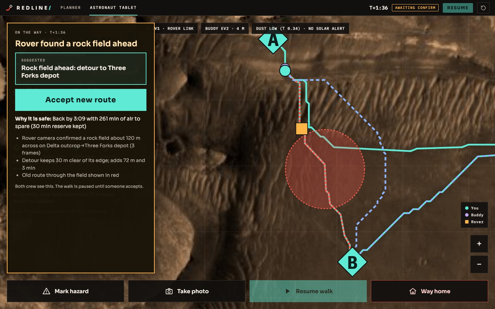
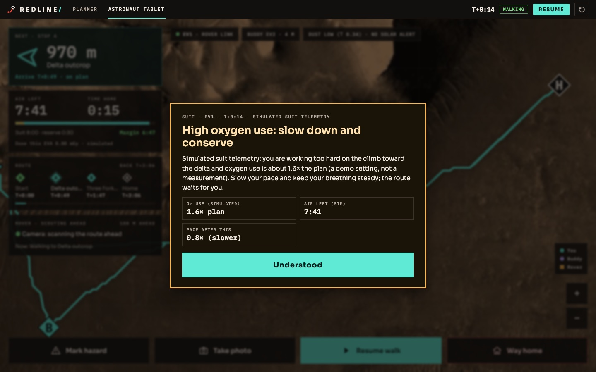
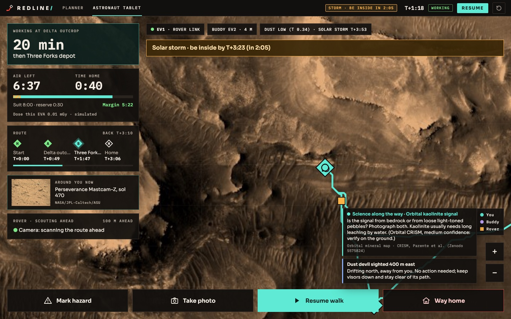
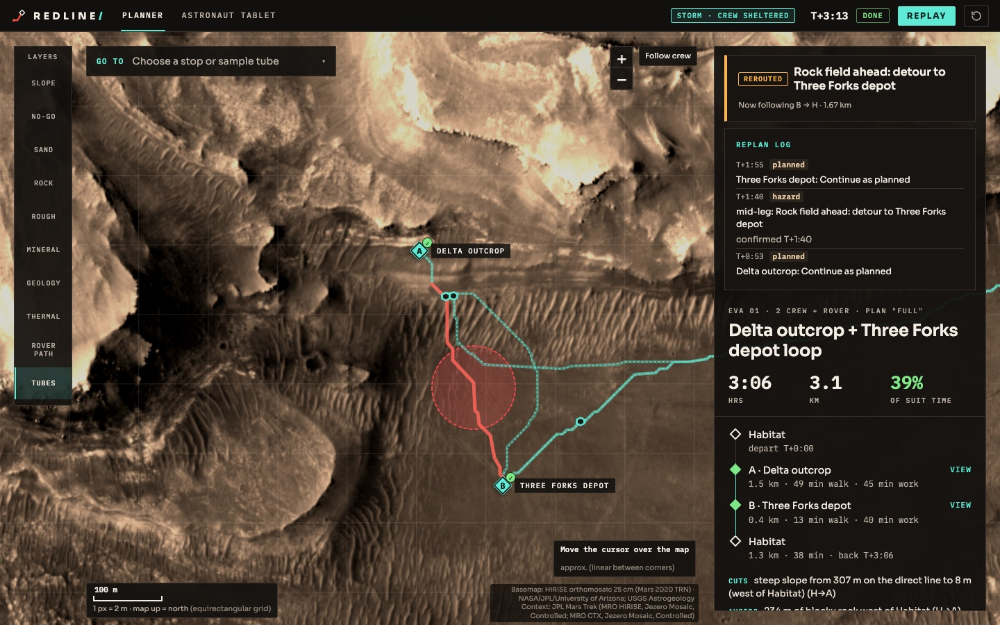

# Redline

**NASA Space Apps 2026 · "Interplanetary Survival Guide: Martian Map"**

Two astronauts have to walk from their habitat in Jezero crater to a delta outcrop where water once flowed, then on to the Three Forks depot to collect the sample tubes Perseverance left there, and get home before their air runs out or a solar storm arrives. Redline is the hyperlocal map and EVA planner for that walk.
It stacks **13 sourced datasets** for one 4 km × 4 km box on a single true-scale 2 m grid. The data comes from four Mars spacecraft (MRO, Mars Odyssey, Perseverance, Curiosity) plus NASA's DONKI space-weather service. On that grid it plans the safest route and then **flies the EVA live**. The sim follows safety rules, the support rover scouts ahead, and the app reroutes around hazards. There are two views: a **Planner** for mission control and an **Astronaut tablet** for the crew.
Every number on screen is labeled **PRIMARY**, **SECONDARY** or **ASSUMPTION**. Anything simulated says so.

**Live app: https://reuhenbhalod.github.io/Redline/** (no login)



## Try it in 60 seconds

1. **[Open the planner](https://reuhenbhalod.github.io/Redline/web/?mode=planner)** and press **Play**. At the default 600× speed the 3-hour walk takes about 3 minutes, and these events happen in order:
   - **T+0:14:** a suit O2 pop-up appears (simulated telemetry). Press Understood and the crew slows down.
   - **Arrival at the delta outcrop:** a solar-storm forecast arrives, modeled on a real DONKI CME arrival at Mars. A countdown chip shows the deadline to be inside.
   - **T+1:36:** the rover's camera confirms a rock field and the app proposes a detour. Press **Accept new route**. The old route stays on the map in red.
   - **About T+3:13:** the crew is back inside, about 10 min before the storm deadline.
2. **[Stop A dossier](https://reuhenbhalod.github.io/Redline/web/?mode=planner&stop=A).** It shows real Perseverance images, why the stop was chosen, the rock unit, CRISM minerals and the planned times.
3. **[Astronaut tablet, mid-walk](https://reuhenbhalod.github.io/Redline/web/?mode=tablet&t=40&events=0).** The tablet shows the next stop, air left against time home, the "what you'll see" photo, and glove-sized buttons. Use **Mark hazard** to pin a hazard where you stand. After that, every route keeps 40 m clear of it.
4. **[Rock-field reroute](https://reuhenbhalod.github.io/Redline/web/?mode=tablet&t=97&events=0).** The detour card shows why the new route is safe. The old route is drawn in red through the field.
5. **[Rover link lost](https://reuhenbhalod.github.io/Redline/web/?mode=tablet&fault=link&t=30&events=0).** The suit switches to suit-only mode: dead-reckoned position, a growing uncertainty ring, and the saved way home.

URL options: `mode=planner|tablet`, `t=<sim minutes>` (seek), `stop=A|B|H`, `variant=skipA`, `fault=link,air,storm` (`nohazard` turns the rock field off), `events=0` (no scripted pop-ups). Keys: `1`/`2` switch views, space plays or pauses, `r` restarts.

| Stop A dossier | Tablet mid-walk | Rock-field reroute |
| --- | --- | --- |
|  |  |  |
| **O2 pop-up (simulated)** | **Storm forecast + science prompt** | **After the walk: old route in red** |
|  |  |  |

Rover link lost: [05-tablet-link-lost.jpg](docs/ui-screens/05-tablet-link-lost.jpg).

## Challenge objectives → features

| The challenge asks for (our reading) | Redline |
| --- | --- |
| A hyperlocal Martian map for surface operations | One 4 km box at Jezero on a true-scale 2 m grid, using the HiRISE 25 cm basemap and DTM. It has 8 overlays (slope, rough ground, rocks, sand, no-go, geology, CRISM minerals, thermal inertia), and each overlay has its own legend and source. |
| Show hazards and safe paths | The no-go mask combines slope over 20°, roughness over 0.5 m and missing data. The route engine finds the lowest-cost safe path (slope, sand and rock slow-downs). The app shows minutes home from every cell. |
| Help the crew survive: air, time, environment | The suit budget is 480 min with a 30 min reserve. Air left is checked against the walk home. The app shows dust τ, MEDA temperatures, a radiation dose from the Curiosity RAD stand-in, and the DONKI CME forecast with a shelter deadline. |
| Adapt when things go wrong | A replan rule runs at every stop and checkpoint. Live A* detours on the walking-time grid route around rover-confirmed rock fields and hazards the crew marks. The app also handles link loss (suit-only mode) and a storm abort. |
| Science value of the walk | Stops are chosen from the data: delta clays where Perseverance cored Bearwallow, and the 10-tube Three Forks depot. "Science along the way" prompts fire where the mapped unit or CRISM mineral changes. |
| Use NASA data | 13 sources, listed below with URLs, licenses and processing steps in [`data/provenance.json`](data/provenance.json). |

## Data

| Dataset | Mission / source | Used for | How the app labels it |
| --- | --- | --- | --- |
| HiRISE DTM mosaic (Mars 2020 TRN, USGS) | MRO | Slope, roughness, no-go, route cost, time home | Measured; thresholds are SECONDARY / ASSUMPTION |
| HiRISE orthomosaic 25 cm | MRO | Basemap | Imagery |
| CTX DTM (backup) | MRO | Habitat flatness pre-screen, QA | Imagery / QA |
| JPL Mars Trek (HiRISE + CTX Jezero mosaics) | MRO | Zoomed-out context | Context layer |
| CRISM dominant mineralogy (Parente et al.) | MRO | Minerals overlay, stop choice, route science prompts | Orbital, 36 m; prompts say "verify on the ground" |
| THEMIS thermal inertia (Edwards & Buz) | Mars Odyssey | Context overlay | Context only, 100 m |
| Photogeologic map (Stack et al. 2020) | Mars 2020 science team (on HiRISE) | Sand, rocky ground, rock units, route science prompts | Interpreted map, 1:5000 |
| Waypoints and traverse (MMGIS) | Perseverance | Real rover path overlay, sols for photos | Measured |
| Three Forks Depot Bundle (PDS) | Perseverance | 10 tube positions, drop sols 653–690, close-ups | Measured |
| Raw images | Perseverance | Stop photos, "what you'll see" | Real images, credited |
| MEDA (PDS Atmospheres) | Perseverance | Air and ground temperature, pressure, dust τ | Dust τ 0.34 is an ESTIMATE (range 0.16–0.53) |
| RAD RDR (PDS PPI) | Curiosity | Dose rate (~219 µGy/day); EVA dose = rate × time outside | STAND-IN (Gale crater, not Jezero) |
| DONKI WSA-ENLIL | NASA CCMC | CME arrivals at Mars; the scripted storm is modeled on a real one | Forecast; storm timing in the demo is simulated |

Safety parameters are in [`data/safety_params.json`](data/safety_params.json), each with its basis and source. PRIMARY values include the 480 min suit budget and 30 min reserve (xEMU / EMU docs), the 2.0 km/h walk speed and 2.7 km/h walk-back speed (Apollo Lunar Surface Journal), and the 10 km max walk-back. The 20° slope limit is SECONDARY. The 15° soft slope, 0.5 m roughness, sand and rock speed factors, Tobler slope shape, and the work times (45 min at A, 40 min at the depot) are ASSUMPTIONS.

Simulated in the demo, and labeled as such in the UI: the O2 spike (1.6× burn, then 0.8× pace), the storm's timing, the rover's rock field (a scripted demo hazard), and the crew position while the link is lost.

## Data pipeline

Everything the app reads is in `data/`, built by `pipeline/` from NASA and USGS sources.

```bash
python3 -m venv .venv && .venv/bin/pip install -r requirements.txt
.venv/bin/python pipeline/run.py          # full Data rebuild, stages 00-06 then 08-09 (~5 min, reads ~1.8 GB of HiRISE remotely)
.venv/bin/python pipeline/run.py 03       # rebuild from a stage onward
.venv/bin/python pipeline/07_routes.py    # route engine (run before 08/09 when routes change)
NASA_API_KEY=... .venv/bin/python pipeline/05_env.py   # DONKI with a real key (DEMO_KEY otherwise)
```

| Stage | Does | Writes |
| --- | --- | --- |
| `00_fetch.py` | Downloads small sources and verifies md5 / structure | `raw/`, `raw/manifest.json` |
| `01_site.py` | Tube positions, stop A shortlist, habitat, 4 km box, local true-scale CRS | `bounds.json`, `depot.json`, `site.json` |
| `02_terrain.py` | HiRISE window crop, 1 m local DTM, slope, roughness, basemap | `basemap.png`, `pipeline/work/terrain.npz` |
| `03_layers.py` | Stack map sand / rocky / units, CRISM minerals, THEMIS, final stop A | `pipeline/work/layers.npz`, `site.json` |
| `04_rover.py` | Rover path, stop photos, tube close-ups | `rover_path.json`, `photos.json`, `depot.json` |
| `05_env.py` | MEDA weather and dust estimate, RAD stand-in, DONKI | `env_data.json` |
| `06_export.py` | Overlay PNGs, legends, grids, safety params, provenance, QA checks | `layers/*.png`, `layers.json`, `grids.npz`, `safety_params.json`, `provenance.json` |
| `07_routes.py` | Route engine (see below) | `routes.json`, `time_home.bin`, `stops.json` |
| `08_walk_grid.py` | Walking-time grid for live detours in the browser (4 m cells, same terrain model) | `walk_time.bin`, `walk_grid.json` |
| `09_route_science.py` | Points along each route where the mapped unit or CRISM mineral changes, turned into field prompts | `route_science.json` |

### The site

- **Habitat (H)** at px `[1298, 868]`: smooth crater floor, mean slope 0.8° within 100 m, 1.2 km from the depot.
- **Stop A** at px `[702, 955]`: delta-front outcrop ("Delta thinly layered") where Perseverance cored **Bearwallow** (sol 516). CRISM shows a clay-bearing signal there. It is 357 m from the depot.
- **Stop B, Three Forks depot**: 10 tubes within 35 m, positioned from the PDS drop sols.
- **Plan "full"** (H→A→B→H): 3.13 km and 3:06, which is 39% of suit time. Backup "skipA" (H→B→H): 2.57 km, 1:57.
- Grid: 2000 × 2000 px, 2 m/px, true scale, origin top-left, x east, y south. Leaflet `CRS.Simple`.

### Validation (`pipeline/qa/`)

- Rover-logged elevation vs. our DTM at 248 waypoints: the median residual is 3 cm, so the coordinate chain lands on the right cells.
- 0.29% of the cells on Perseverance's own drive path inside the box are no-go, so the hazard mask agrees with ground a rover actually drove.
- The habitat, stop A and all 10 tubes are connected through walkable cells.
- 1 px = 2.0000 m both east-west and north-south (true-scale check).

## Route engine (`pipeline/07_routes.py`)

The engine turns the aligned terrain layers into a cost grid and finds the cheapest safe path for each leg. It precomputes every route variant and writes `routes.json` and `time_home.bin` for the web app.

```bash
.venv/bin/python pipeline/07_routes.py --preview           # real data -> data/routes.json, time_home.bin, stops.json
.venv/bin/python pipeline/07_routes.py --fake --preview    # fake hilly terrain -> work/fake/out/ (also --scenario sand_maze|easy|cliff)
.venv/bin/python pipeline/07_routes.py --coarsen 3         # plan on a 6 m grid if pathfinding is slow
.venv/bin/python pipeline/tune_weights.py --fake           # compare cost-weight sets
.venv/bin/python -m pytest tests
```

The engine reads `data/grids.npz`, `safety_params.json` (every speed, limit, budget and work time comes from this file), `site.json`, `photos.json` and `depot.json`. Engine-only knobs live in `pipeline/engine_config.py`: cost weights, safety buffer, checkpoints and the scripted rock-field `hazard_demo`.

For each variant, `routes.json` holds the path, the `t_min`/`home_min` timelines, legs, the stop plan, replan options at each stop, and mid-leg `checkpoints`. Every export is checked against the contract (`engine.validate_routes`) before it is written. Start with the [Engine guide](docs/engine_guide.md) and `examples/engine_quickstart.py`.

## Web app

`web/` is a static ES-module app with no build step and no install. It uses Leaflet 1.9.4 from unpkg. Serve the repo root (`python3 -m http.server 8000`) and open `http://localhost:8000/web/`. See [web/README.md](web/README.md) for the views, controls and demo script, and [web/INTERFACES.md](web/INTERFACES.md) for the state, event and data contracts. Run `node --test web/tests` to test the sim. Before pushing a change under `web/`, run `python3 tools/stamp_version.py`, because Pages caches modules.

Design notes: [docs/architecture.md](docs/architecture.md), [docs/ui-redesign.md](docs/ui-redesign.md).

## Credits

HiRISE: NASA/JPL/University of Arizona. CTX: NASA/JPL/MSSS. USGS Astrogeology (Mars 2020 TRN products). Perseverance images: NASA/JPL-Caltech (Mastcam-Z: NASA/JPL-Caltech/ASU). Stack et al. 2020 (CC-BY-4.0). Parente, Saranathan, Itoh, Tarnas (CC-BY-4.0). Edwards & Buz (CC-BY-4.0). PDS Geosciences, Atmospheres and PPI nodes. NASA CCMC DONKI. JPL Mars Trek.

## AI use

The pipeline and web app code were written with AI assistance (Claude). All data values come from the sources listed above, and every processing step is in `pipeline/` and can be reproduced with one command. The scripted demo events (O2 spike, storm timing, rock field) are simulated and labeled that way in the app.
